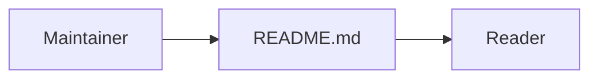

# Requirements Analysis (Lite)

## Classification
| ID | Type | Requirement | MoSCoW |
|---|---|---|---|
| FR-1 | FR | README.md shall contain the sentence "This repository is the ERH connector test repository." | Must |
| CON-1 | Constraint | Only this one sentence is added; no other content or file changes. | Must |
| CON-2 | Constraint | No application code is created; documents stay minimal. | Must |

No NFRs. No conflicts. No [TBD]/[fishy] items. Checklist (BIZ+USR): purpose, stakeholders and scope are covered; the rest is not applicable.

## Fit criterion
README.md differs from the base only by the added sentence above.

## Context

